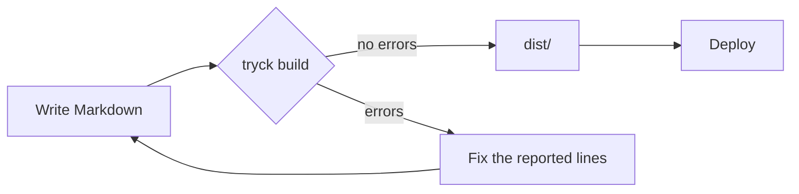

## Syntax highlighting

Fenced code blocks with a language are highlighted by chroma, using CSS classes rather than inline styles. The `syntaxHighlighting` plugin is on by default and writes its rules to `/css/chroma.css`, which the built-in layout links in `<head>`.

```go
package main

func main() { println("hello") }
```

Configure it under `plugins.syntaxHighlighting`:

| Option | Default | Meaning |
| :- | :- | :- |
| `theme` | `github` | Chroma style for light mode. |
| `darkTheme` | `github-dark` | Chroma style for dark mode; empty uses `theme` in both. |
| `lineNumbers` | `true` | Show line numbers in each block. |

```yaml
plugins:
  syntaxHighlighting:
    theme: "github"
    darkTheme: "github-dark"
    lineNumbers: false
```

The style name must exist in [chroma's style gallery](https://github.com/alecthomas/chroma/tree/master/styles); an unknown name is a `plugin.config` error. Light and dark rules are scoped so a rule never applies in both modes.

## Diagrams with mermaid

A fenced block with the language `mermaid` is rendered as a diagram:



The diagram above is written as:

````markdown

````

Any diagram type mermaid supports works, such as sequence diagrams, class diagrams and Gantt charts. Without JavaScript the block shows its source in a `<pre class="mermaid">`. On pages that contain a diagram, tryck adds a module script that loads mermaid and draws it.

The `mermaid` plugin has one option, `url`, the module to load. The default is mermaid 11 from jsDelivr:

```yaml
plugins:
  mermaid:
    url: "https://cdn.jsdelivr.net/npm/mermaid@11/dist/mermaid.esm.min.mjs"
```

To run offline, save the mermaid module under `static/` and point `url` at that site path, for example `/js/mermaid.esm.min.mjs`. An empty `url` is a `plugin.config` error. The diagram is redrawn when the page switches between light and dark.

## Math

Write formulas in TeX, the way GitHub and most Markdown tools accept them. tryck renders them at build time with [KaTeX](https://katex.org) to MathML, which browsers display natively, so pages need no script or stylesheet for math. Browsers draw MathML with a math font installed on the reader's system, such as Cambria Math on Windows and STIX Two Math on macOS; the built-in theme asks for these and the common Linux ones (Latin Modern Math, Noto Sans Math) by name. A formula too wide for the page scrolls sideways in its own box.

The area of a circle is $A = \pi r^2$, and

$$
\int_{-\infty}^{\infty} e^{-x^2}\,dx = \sqrt{\pi}
$$

is written as:

```markdown
The area of a circle is $A = \pi r^2$, and

$$
\int_{-\infty}^{\infty} e^{-x^2}\,dx = \sqrt{\pi}
$$
```

There are three forms:

| Syntax | Shows |
| :- | :- |
| `$...$` | A formula within the text. |
| `$$...$$` | A displayed formula, on a line of its own. On lines of its own (as above), or on one line, it is a block; within a paragraph it is displayed where it stands. |
| ` ```math ` block | A displayed formula, as on GitHub. |

A single `$` is only math when it looks like math, so prices and shell variables in text stay as they are:

- the opening `$` must be followed by a non-space character, and the closing `$` preceded by one and not followed by a digit, so `$5 and $10` is text,
- a formula ends at a code span, so `` costs $5 with `$HOME` set `` is text,
- `\$` is always a dollar sign.

Formulas in code spans and code blocks are never rendered. A formula may span lines.

A formula KaTeX cannot parse is a `math.error` warning with its line, and the page shows its source as code, with KaTeX's message as a tooltip:

```
content/guide/stats.md:12: warning[math.error]: Expected '}', got 'EOF' at end of input: \frac{1}{2
```

The `math` plugin has two options:

```yaml
plugins:
  math:
    inline: false        # only $$...$$ and ```math; a single $ is always text
    macros:              # your own commands, used in every formula
      '\RR': '\mathbb{R}'
      '\norm': '\left\lVert #1 \right\rVert'
```

Write macro names and definitions in single quotes, where a backslash needs no escaping. Every command [KaTeX supports](https://katex.org/docs/supported) works. Formulas render in every current browser; a displayed formula wider than the page scrolls on its own.

## Copying code

In the built-in theme every code block gets a **Copy** button, which copies the code without line numbers.

## Heading IDs

Every heading gets an ID derived from its text, so you can link to `#a-heading`. The text is lowercased, letters and digits are kept (including non-ASCII), runs of spaces, dashes and underscores become a single dash, and other punctuation is dropped:

| Heading | ID |
| :- | :- |
| `## Setup & Install` | `setup-install` |
| `## Översikt 2.0` | `översikt-20` |

When two headings in a page would get the same ID, the later ones get a numeric suffix: `setup-install`, `setup-install-1`, `setup-install-2`. This keeps anchors unique, and the build notes it as an info diagnostic (`heading.duplicateId`) when you run with `--verbose`.

To choose the ID yourself, add an attribute to the heading:

```markdown
## Install {#installation}
```

Now the heading's ID is `installation`. Every heading below the page title also gets a `#` link to its ID, shown on hover, for linking to that section; `defaults.headingAnchors: false` turns these off. Custom IDs are also what the `toc` plugin and anchor checking use.
