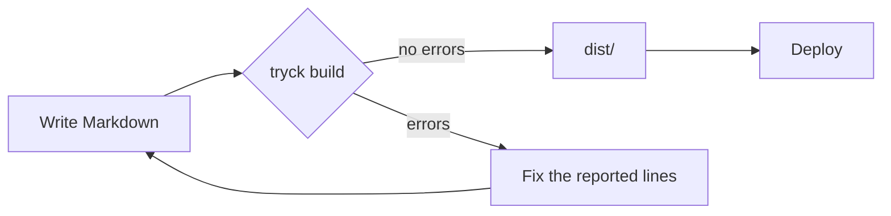

## Syntax highlighting

Fenced code blocks with a language are highlighted by chroma, using CSS classes rather than inline styles. The `syntaxHighlighting` plugin is on by default and writes its rules to `/css/chroma.css`, which the built-in layout links in `<head>`.

```go
package main

func main() { println("hello") }
```

Configure it under `plugins.syntaxHighlighting`:

| Option | Default | Meaning |
| :- | :- | :- |
| `theme` | `github` | Chroma style for light mode. |
| `darkTheme` | `github-dark` | Chroma style for dark mode; empty uses `theme` in both. |
| `lineNumbers` | `true` | Show line numbers in each block. |

```yaml
plugins:
  syntaxHighlighting:
    theme: "github"
    darkTheme: "github-dark"
    lineNumbers: false
```

The style name must exist in [chroma's style gallery](https://github.com/alecthomas/chroma/tree/master/styles); an unknown name is a `plugin.config` error. Light and dark rules are scoped so a rule never applies in both modes.

## Diagrams with mermaid

A fenced block with the language `mermaid` is rendered as a diagram:



The diagram above is written as:

````markdown

````

Any diagram type mermaid supports works, such as sequence diagrams, class diagrams and Gantt charts. Without JavaScript the block shows its source in a `<pre class="mermaid">`. On pages that contain a diagram, tryck adds a module script that loads mermaid and draws it.

The `mermaid` plugin has one option, `url`, the module to load. The default is mermaid 11 from jsDelivr:

```yaml
plugins:
  mermaid:
    url: "https://cdn.jsdelivr.net/npm/mermaid@11/dist/mermaid.esm.min.mjs"
```

To run offline, save the mermaid module under `static/` and point `url` at that site path, for example `/js/mermaid.esm.min.mjs`. An empty `url` is a `plugin.config` error. The diagram is redrawn when the page switches between light and dark.

## Heading IDs

Every heading gets an ID derived from its text, so you can link to `#a-heading`. The text is lowercased, letters and digits are kept (including non-ASCII), runs of spaces, dashes and underscores become a single dash, and other punctuation is dropped:

| Heading | ID |
| :- | :- |
| `## Setup & Install` | `setup-install` |
| `## Översikt 2.0` | `översikt-20` |

When two headings in a page would get the same ID, the later ones get a numeric suffix: `setup-install`, `setup-install-1`, `setup-install-2`. This keeps anchors unique, and the build notes it as an info diagnostic (`heading.duplicateId`) when you run with `--verbose`.

To choose the ID yourself, add an attribute to the heading:

```markdown
## Install {#installation}
```

Now the heading's ID is `installation`. Custom IDs are also what the `toc` plugin and anchor checking use.
