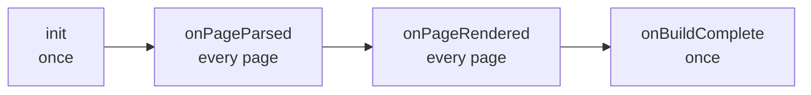

A JavaScript file in `plugins/` is a plugin. tryck runs it with a built-in JavaScript engine, so there is nothing to install or compile: the stock `tryck` binary picks it up, in `tryck build` and `tryck dev` alike. Script plugins have the same hooks as [Go plugins](05-go-plugins/_index.md): they can add data to pages, change the rendered HTML, write extra files and report diagnostics.

For example, this script adds an "Edit this page on GitHub" link at the end of every page. (The built-in theme can do this on its own with [`theme.editUrl`](../04-themes/01-built-in-theme.md); the script shows how it works.)

```js
// Adds an "Edit this page" link to the end of every page's article.
var configKeys = ["repo", "branch"];

function init(config) {
  return {
    repo: config.repo ?? "https://github.com/Pinta365/tryck",
    branch: config.branch ?? "main",
  };
}

function onPageRendered(page, state) {
  const url = `${state.repo}/edit/${state.branch}/docs/content/${page.sourcePath}`;
  const link = `<p class="edit-link"><a href="${url}">Edit this page on GitHub</a></p>`;
  page.html = page.html.replace("</article>", link + "\n</article>");
}
```

## Files and names

Scripts live in `plugins/` next to `content/` (set `build.pluginsDir` to use another directory), one plugin per `.js` file. The file name is the plugin's name: `plugins/edit-link.js` is the plugin `edit-link`, configured under `plugins.edit-link`:

```yaml
plugins:
  edit-link:
    branch: develop
```

Like every plugin, a script is enabled unless its section sets `enabled: false`. A [theme folder](../04-themes/02-theme-folders.md) can ship scripts in its own `plugins/`; a site script with the same file name replaces the theme's.

A script cannot take the name of a built-in or Go plugin; that is a `plugin.config` error.

## The hooks

A script defines any of these functions. All are optional.

| Function | Runs | Can |
| :- | :- | :- |
| `init(config, site)` | Once per build, before any page. | Read its config section and return the **state** passed to every other hook. |
| `onPageParsed(page, state)` | Per page, after the Markdown is parsed. | Set `page.data`. |
| `onPageRendered(page, state, site)` | Per page, after the layout ran. | Change `page.html` and `page.data`. Look up other pages through `site`. |
| `onBuildComplete(site, out, state)` | Once, after every page is rendered. | Read every page and its data, add output files. |

Three optional top-level variables configure the plugin:

| Variable | Meaning |
| :- | :- |
| `configKeys` | The keys of the plugin's config section, such as `["repo", "branch"]`. Other keys are `config.unknownKey` warnings. Without it, any key is accepted. |
| `priority` | Order among plugins: lower runs first, default `100`. Plugins with equal priority run by name. |
| `stylesheets` | Site paths of CSS files to link on every page, such as `["/css/edit-link.css"]`. Put the files in `static/`. |



## What the hooks receive

**`config`** is the plugin's section from `plugins:`, without `enabled`. It is `{}` when there is no section.

**`site`** in `init` holds `title`, `description`, `baseUrl`, `language`, `version` (the current version's name, or `""`) and `dev` (true in `tryck dev`). `onPageRendered` adds three lookups:

- `site.page(url)`: another page by URL (`url`, `title`, `description`, `date`, `data`, ...), or `null`,
- `site.hasFile(path)`: whether a site path such as `/img/logo.png` exists,
- `site.hasAnchor(url, id)`: whether a page has an element with that ID.

In `onBuildComplete`, `site.pages` lists every page (`url`, `sourcePath`, `title`, `navTitle`, `description`, `date`, `lastUpdated`, `draft`, `weight`, `aliases`, `params`, `data`), sorted by URL, and `site.nav` is the navigation tree (`title`, `url`, `section`, `draft`, `children`).

**`page`** in the page hooks holds:

| Field | Meaning |
| :- | :- |
| `url`, `sourcePath`, `title` | The page's URL, its file relative to its content directory, and its front matter title. |
| `version` | The page's version on a [versioned site](../02-writing/06-versioned-docs.md), or `""`. |
| `front` | The front matter, including your own keys: `page.front.status`. |
| `source` | The Markdown body, without the front matter. |
| `headings` | Every heading: `{level, id, text}`. |
| `data` | Values for layouts, available as `.Page.Data`. Includes what earlier plugins added, such as `readingTime` and `toc`. Writable. |
| `html` | The rendered page, in `onPageRendered` only. Writable. |
| `report(severity, message, line)` | Reports a diagnostic. See below. |

**`out`** in `onBuildComplete` has `out.add(path, text)`, which writes a file relative to the output directory, and `out.report(severity, message)`.

## State and parallel pages

tryck processes pages in parallel, and every page hook starts from a fresh copy of the script. A top-level variable is therefore reset for every page:

```js
let count = 0;

function onPageParsed(page) {
  count++;              // always 1: each page starts from scratch
  page.data.n = count;
}
```

This keeps builds the same no matter how pages are spread over workers. To share something across pages, compute it in `init` and return it as state, which every hook receives as a copy. To collect something from every page, set it in `page.data` and read it back in `onBuildComplete`:

```js
function onPageParsed(page) {
  page.data.todo = (page.source.match(/TODO/g) ?? []).length;
}

function onBuildComplete(site, out) {
  const pages = site.pages.filter((p) => p.data.todo > 0);
  out.add("todo.txt", pages.map((p) => `${p.url} ${p.data.todo}`).join("\n") + "\n");
}
```

Only plain data crosses between tryck and a script: strings, numbers, booleans, arrays and objects. Functions and other values in `page.data` or the state are dropped.

## Diagnostics and errors

`page.report(severity, message, line)` reports a problem with the page. `severity` is `"error"`, `"warning"` or `"info"`, and `line` is a line in `page.source` (or `0`); tryck turns it into a line in the file. The code is the plugin's name:

```js
function onPageParsed(page) {
  page.source.split("\n").forEach((text, i) => {
    if (text.includes("TODO")) page.report("warning", "unfinished section", i + 1);
  });
}
```

```
content/guide/setup.md:14: warning[todo]: unfinished section
```

An `"error"` fails the build, like any error. A script that throws, or has a syntax error, is reported with its position in the script:

```
content/index.md: error[plugin.error]: plugin todo: onPageParsed: TypeError: Cannot read property 'x' of undefined (plugins/todo.js:2:25)
plugins/todo.js:2:15: error[plugin.config]: syntax error: Unexpected token (
```

## The JavaScript

Scripts run in [goja](https://github.com/dop251/goja), a JavaScript engine written in Go. Modern JavaScript works: `let` and `const`, arrow functions, template strings, destructuring, spread, classes, optional chaining (`?.`) and `??`, `Map` and `Set`, regular expressions with named groups, `JSON`.

There is no `import` or `export`: a script is a plain file of functions. There are no npm packages, no Node.js APIs, and no access to files, the network or other programs. A script only sees what tryck passes to it, so a theme's scripts cannot reach outside the build.

## When to use what

- To give a `:::` block its own HTML, a [directive template](02-custom-directives.md) is simpler.
- To change the Markdown parser itself, or when you need Go libraries, use a [Go plugin](05-go-plugins/_index.md).
- For everything else that adds data, changes pages or writes files, a script is the quickest way.
