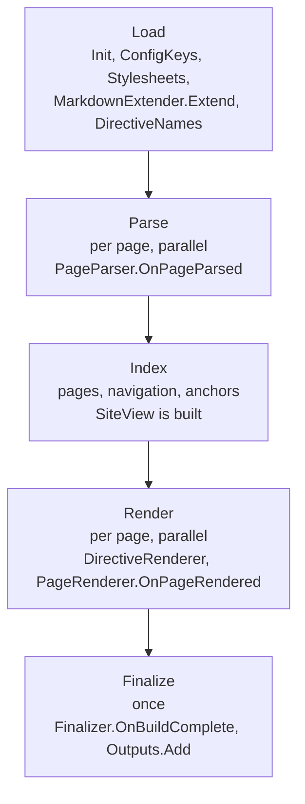

A plugin is a Go type that implements `plugin.Plugin` and any of the phase interfaces in [`pkg/plugin`](https://github.com/Pinta365/tryck/tree/main/pkg/plugin). Plugins are compiled into the binary, so a custom site ships as one executable.

## A custom binary

`tryck` is itself a thin wrapper around the package `pkg/tryck`. A binary with extra plugins is one call:

```go
package main

import (
	"github.com/Pinta365/tryck/pkg/plugin"
	"github.com/Pinta365/tryck/pkg/tryck"
)

type Hello struct{ greeting string }

func (*Hello) Name() string         { return "hello" }
func (*Hello) ConfigKeys() []string { return []string{"greeting"} }

func (h *Hello) Init(cfg map[string]any, _ plugin.SiteInfo) error {
	h.greeting = "Hello"
	if v, ok := cfg["greeting"].(string); ok {
		h.greeting = v
	}
	return nil
}

func (h *Hello) OnPageParsed(p *plugin.Page) error {
	p.Data["greeting"] = h.greeting
	return nil
}

func (h *Hello) OnBuildComplete(s plugin.SiteView, out plugin.Outputs) error {
	return out.Add("hello.txt", []byte(h.greeting+"\n"))
}

func main() { tryck.Main(&Hello{}) }
```

Build it with `go build`, like any Go program. [Using plugins](01-using-go-plugins.md) covers setting up the module, configuring the plugin and deploying with the custom binary. `tryck.Main(plugins ...plugin.Plugin)` runs `os.Args` and exits with the same codes as the stock binary. For a library — a test, or a tool that only builds sites — call `tryck.Run(args, stdout, stderr, plugins...)` and get the exit code back.

A plugin's `Name` is its key under `plugins:` in the config file. Two plugins with the same name are a `plugin.config` error and the later one is skipped.

`examples/plugin-hello` in the repository is this plugin, complete and tested. Run it with `go build ./examples/plugin-hello`.

## The build phases



| Interface | Method | When |
| :- | :- | :- |
| `Plugin` | `Name() string`, `Init(cfg map[string]any, site SiteInfo) error` | Once, before any page. Every plugin implements this. |
| `Ordered` | `Priority() int` | Ordering only; lower runs first, default 100. |
| `ConfigKeys` | `ConfigKeys() []string` | Declares the plugin's config keys. |
| `MarkdownExtender` | `Extend(m goldmark.Markdown)` | Once, before parsing. |
| `PageParser` | `OnPageParsed(p *Page) error` | Per page, in parallel, after parsing. |
| `PageRenderer` | `OnPageRendered(p *Page, s SiteView) error` | Per page, in parallel, after the layout runs. |
| `Finalizer` | `OnBuildComplete(s SiteView, out Outputs) error` | Once, after every page is rendered. |
| `DirectiveRenderer` | `DirectiveNames() []string`, `RenderDirective(w io.Writer, d Directive, entering bool) error` | While rendering pages that use the directive. |
| `Stylesheets` | `Stylesheets() []string` | Once, to collect CSS to link in `<head>`. |

Plugins are ordered by `Priority` and then by name. `Init` receives the plugin's config section (nil when absent) and the site settings. A plugin that implements none of the optional interfaces is still listed and initialized.

## Init and reused instances

`Init` runs at the start of every build. The same plugin value is used for every rebuild in `tryck dev`, so reset any per-build state in `Init` instead of relying on zero values.

`OnPageParsed` and `OnPageRendered` run for many pages at once. A plugin that collects data across pages must guard it, for example with a `sync.Mutex`.

## Config keys

Implement `ConfigKeys` to list the keys of your plugin's section. tryck warns about any other key, so a typo like `greetng` is reported instead of silently ignored. `enabled` is always allowed and does not need to be listed. A third-party plugin's keys are checked the same way as a built-in's.

## Changing a page

`OnPageParsed` receives the parsed page. You may modify that page's own fields, such as `p.Data`, but you must not modify `p.AST`: `tryck dev` reuses parsed ASTs across rebuilds, and a mutation would show up in later builds. To change the document itself, implement `MarkdownExtender` and register a goldmark parser, AST transformer or renderer in `Extend`.

`OnPageRendered` runs after the layout and may modify `p.HTML` and `p.Data`. The `SiteView` it receives is read-only.

```go
func (m *MyPlugin) OnPageRendered(p *plugin.Page, s plugin.SiteView) error {
	p.HTML = bytes.ReplaceAll(p.HTML, []byte("</body>"), []byte("<footer>...</footer></body>"))
	return nil
}
```

## Directives

Implement `DirectiveRenderer` to render `:::name` blocks that tryck does not know. When the HTML only depends on the title, attributes and body, a [directive template](../02-custom-directives.md) is simpler. List the names in `DirectiveNames`; claiming a built-in name (`note`, `tip`, `info`, `warning`, `danger`, `details`, `tabs`) or a name another plugin already claimed is a `plugin.config` error. `RenderDirective` is called twice, with `entering` true for the opening HTML and false for the closing HTML, and the directive's Markdown content is rendered between the two calls. Registered names no longer produce a `directive.unknown` warning.

## Stylesheets and output files

`Stylesheets` returns site paths, such as `/css/mystyle.css`, that the built-in layout links in `<head>` on every page. Put the file in `static/` (or the theme's `static/`) yourself, or write it from `OnBuildComplete`.

`Finalizer.OnBuildComplete` runs once, after all pages, and receives an `Outputs`. Use `out.Add(path, data)` to add a file to the output, and `out.Report` for a diagnostic that is not about one page. A path that is invalid or already produced is an error, which is reported as `plugin.error`. `Finalizer` runs in the order of the plugins, so a plugin with `Priority` higher than the default 100 runs after the others; `LinkCheck` uses 1000 so it sees every generated file.

## Diagnostics

A plugin reports problems as diagnostics with a stable code:

```go
p.Diags.Report(plugin.Diagnostic{
	Severity: plugin.Warning,
	Line:     line,
	Code:     "myplugin.something",
	Message:  "what is wrong and how to fix it",
})
```

`p.Diags` is safe for concurrent use. From a finalizer, use `out.Report` instead. Severities are `plugin.Info`, `plugin.Warning` and `plugin.Error`; an error makes the build fail. See [Diagnostics](../../07-diagnostics.md) for the format.

Useful methods on the `SiteView`: `Pages()` (every page, sorted by URL), `PageByURL`, `Nav()`, `HasAnchor(url, id)` and `HasFile(sitePath)`.

## Testing a plugin

`tryck.Run` runs the whole command line in-process, so a test can build a site and assert on the result without a separate binary. Start from a generated site, then build with your plugin:

```go
func TestHello(t *testing.T) {
	dir := t.TempDir()
	if code := tryck.Run([]string{"init", dir}, io.Discard, io.Discard); code != 0 {
		t.Fatal("init failed")
	}
	wd, _ := os.Getwd()
	defer os.Chdir(wd)
	os.Chdir(dir)
	var out, errOut bytes.Buffer
	if code := tryck.Run([]string{"build"}, &out, &errOut, &Hello{}); code != 0 {
		t.Fatalf("build failed: %s", errOut.String())
	}
	// read dist/hello.txt
}
```

The test in `examples/plugin-hello` does this, including a case that sets `plugins.hello.greeting` in the config.
