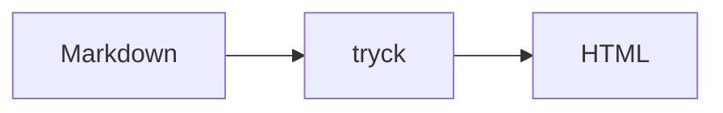

# Directives

:::note[Heads up]
Directives hold **Markdown**, including lists:

- one
- two
:::

::::tabs{group=lang}
@tab TypeScript
```ts
const x = 1;
```
@tab Go
:::tip
Nested directives work inside tabs.
:::
::::

:::details[Click to expand]
Hidden content.
:::


